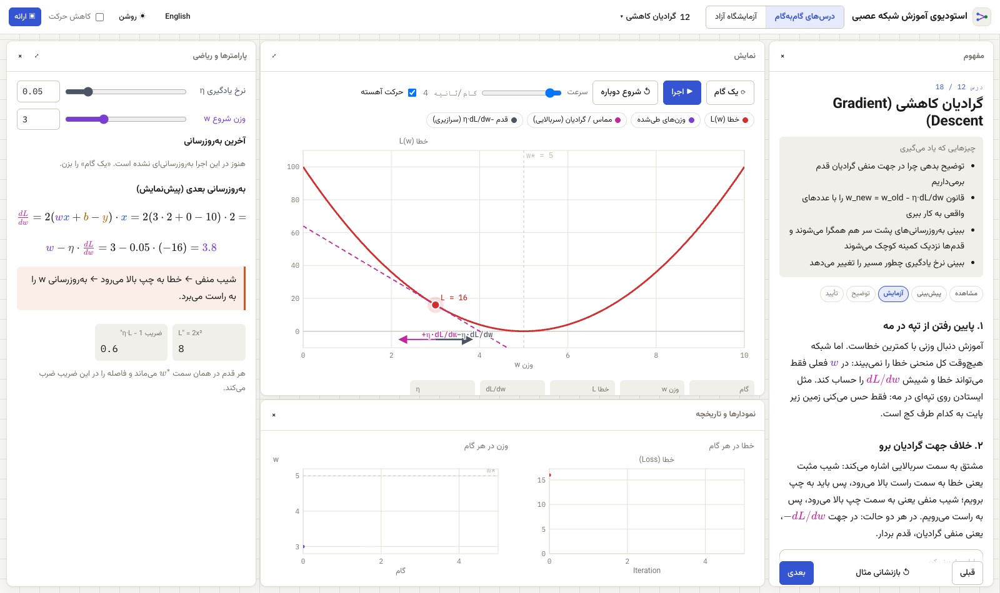

# استودیوی آموزش شبکه عصبی

[English](README.md) · **فارسی**

یک محیط تعاملی و دوزبانه (فارسی / انگلیسی) برای آموزش شبکه‌های عصبی از پایه: ورودی و تابع، وزن و بایاس، توابع فعال‌سازی، انتشار رو به جلو، خطا (Loss)، مشتق، قاعده زنجیره‌ای، پس‌انتشار (Backpropagation)، گرادیان کاهشی و آموزش عملی شبکه.

همه عددهایی که روی صفحه می‌بینید از یک موتور محاسباتی کوچک و دقیق می‌آیند که داخل خود مرورگر اجرا می‌شود. یک وزن، ورودی، تابع فعال‌سازی یا نرخ یادگیری را تغییر دهید؛ نمودار شبکه، معادله‌ها، گرادیان‌ها، نمودارها و تاریخچه آموزش همه با هم به‌روز می‌شوند.



- [نصب و اجرا، قدم به قدم (بدون نیاز به برنامه‌نویسی)](#نصب-و-اجرا-قدم-به-قدم)
- [رفع مشکلات رایج](#رفع-مشکلات-رایج)
- [کار با برنامه](#کار-با-برنامه)

## نصب و اجرا، قدم به قدم

لازم نیست برنامه‌نویسی بلد باشید. برنامه روی کامپیوتر خودتان اجرا می‌شود و در مرورگر باز می‌شود. بار اول حدود ۱۰ دقیقه طول می‌کشد؛ دفعه‌های بعد چند ثانیه.

**چه چیزهایی لازم است**

- کامپیوتر با ویندوز ۱۰ یا ۱۱، مک (macOS) یا لینوکس
- اینترنت (فقط برای نصب بار اول)
- یک مرورگر به‌روز: Chrome، Edge، Firefox یا Safari

### قدم ۱: نصب Node.js (فقط یک بار)

برنامه با جاوااسکریپت ساخته شده و برای اجرا به یک برنامه رایگان به نام **Node.js** نیاز دارد.

1. به سایت **https://nodejs.org** بروید.
2. نسخه‌ای را که کنارش نوشته **LTS** (نسخه پیشنهادی) دانلود کنید.
3. فایل دانلودشده را باز کنید و با تنظیمات پیش‌فرض، مدام **Next** یا **Continue** را بزنید تا نصب تمام شود.
4. بررسی کنید که نصب شده:
   - **ویندوز**: منوی Start را باز کنید، `cmd` را تایپ کنید و **Command Prompt** را باز کنید.
   - **مک**: کلیدهای `Cmd + Space` را بزنید، `Terminal` را تایپ کنید و Enter بزنید.
   - این خط را تایپ کنید و Enter بزنید:

     ```bash
     node -v
     ```

   باید یک شماره نسخه مثل `v22.11.0` ببینید. هر نسخه از `v20` به بالا مناسب است. اگر پیام «not recognized» یا «command not found» دیدید، کامپیوتر را یک بار ری‌استارت کنید و دوباره امتحان کنید.

### قدم ۲: دانلود برنامه

**روش الف: دانلود فایل ZIP (ساده‌ترین روش)**

1. بالای همین صفحه روی دکمه سبز **Code** و بعد **Download ZIP** کلیک کنید.
2. فایل را از حالت فشرده خارج کنید:
   - **ویندوز**: روی فایل ZIP راست‌کلیک کنید ← **Extract All…** ← **Extract**.
   - **مک**: روی فایل ZIP دوبار کلیک کنید.
3. حالا یک پوشه به نام `nn-teaching-studio-main` دارید. آن را جایی بگذارید که راحت پیدا شود، مثلاً روی دسکتاپ.

**روش ب: با Git (اگر از قبل با آن کار می‌کنید)**

```bash
git clone https://github.com/milad9005/nn-teaching-studio.git
```

### قدم ۳: اجرای برنامه

**ویندوز**

1. پوشه `nn-teaching-studio-main` را باز کنید.
2. روی فایل **`start-windows.bat`** دوبار کلیک کنید.
   - اگر ویندوز پیام «Windows protected your PC» نشان داد، روی **More info** و بعد **Run anyway** کلیک کنید.
3. یک پنجره سیاه باز می‌شود. بار اول بسته‌های لازم را دانلود می‌کند (۱ تا ۳ دقیقه). بعد برنامه خودکار در مرورگر باز می‌شود.

**مک**

1. **Terminal** را باز کنید (`Cmd + Space`، تایپ `Terminal`، Enter).
2. کلمه `bash` را تایپ کنید و بعدش یک فاصله (Space) بگذارید. هنوز Enter نزنید.
3. فایل **`start-mac.command`** را از داخل پوشه بکشید و داخل پنجره Terminal رها کنید، بعد Enter بزنید.
4. بار اول بسته‌های لازم را دانلود می‌کند (۱ تا ۳ دقیقه). بعد برنامه خودکار در مرورگر باز می‌شود.

می‌توانید روی `start-mac.command` دوبار کلیک هم بکنید. اگر مک گفت فایل «باز نمی‌شود» یا «از توسعه‌دهنده ناشناس است»، به **System Settings ← Privacy & Security** بروید، پایین صفحه روی **Open Anyway** کلیک کنید؛ یا همان روش Terminal بالا را به کار ببرید.

**روش دستی برای همه سیستم‌ها (از جمله لینوکس)**

یک ترمینال **داخل پوشه برنامه** باز کنید و این دو دستور را اجرا کنید:

```bash
npm install
```

```bash
npm run dev
```

بعد آدرس **http://localhost:5178** را در مرورگر باز کنید.

> باز کردن ترمینال داخل پوشه: در ویندوز روی نوار آدرس پوشه کلیک کنید، `cmd` را تایپ کنید و Enter بزنید. در مک داخل Terminal عبارت `cd` و یک فاصله تایپ کنید، پوشه را داخل پنجره بکشید و Enter بزنید.

### قدم ۴: بستن و اجرای دوباره

- **برای بستن** برنامه، پنجره ترمینال را ببندید (یا داخلش `Ctrl + C` بزنید). فقط بستن تب مرورگر برنامه را متوقف نمی‌کند.
- **برای اجرای دوباره** در دفعه‌های بعد، فقط قدم ۳ را تکرار کنید. دانلود بسته‌ها فقط بار اول انجام می‌شود، پس این بار در چند ثانیه بالا می‌آید.
- بعد از نصب، برنامه بدون اینترنت هم کار می‌کند. زبان، تم، پیشرفت درس‌ها و چیدمان پنل‌ها در مرورگر ذخیره می‌شوند.

## رفع مشکلات رایج

| چه می‌بینید | چه کار کنید |
| --- | --- |
| `'node' is not recognized…` یا `command not found: npm` | Node.js نصب نیست، یا ترمینال قبل از نصب باز شده بود. Node.js را نصب کنید (قدم ۱)، ترمینال را ببندید و دوباره باز کنید. اگر باز هم نشد، کامپیوتر را ری‌استارت کنید. |
| در PowerShell پیام `running scripts is disabled on this system` | به جای PowerShell از **Command Prompt** (`cmd`) استفاده کنید، یا روی `start-windows.bat` دوبار کلیک کنید. |
| `Error: Port 5178 is already in use` | برنامه همین حالا در یک پنجره ترمینال دیگر در حال اجراست. کافی است http://localhost:5178 را باز کنید، یا آن پنجره را ببندید و دوباره امتحان کنید. |
| مرورگر خودش باز نمی‌شود | آدرس **http://localhost:5178** را خودتان در مرورگر باز کنید. |
| `npm install` با خطای شبکه متوقف می‌شود | اتصال اینترنت را بررسی کنید و دوباره امتحان کنید. در شبکه‌های اداری ممکن است پراکسی یا فایروال جلویش را بگیرد. اگر اینترنت محدود است، فیلترشکن یا شبکه دیگری را امتحان کنید. |
| `npm install` با خطای دیگری متوقف می‌شود | پوشه `node_modules` را از داخل پوشه برنامه پاک کنید و دوباره `npm install` را اجرا کنید. هیچ‌وقت آن را با `sudo` اجرا نکنید. |
| نسخه Node.js قدیمی است (`v18` یا پایین‌تر) | نسخه LTS جدید را از https://nodejs.org نصب کنید؛ جای نسخه قبلی را می‌گیرد. |
| مک: پیام `permission denied` هنگام دوبار کلیک روی `start-mac.command` | از روش Terminal استفاده کنید (`bash` و کشیدن فایل داخل پنجره). |
| صفحه سفید است یا به‌هم‌ریخته به نظر می‌رسد | صفحه را با `Ctrl + Shift + R` (ویندوز) یا `Cmd + Shift + R` (مک) تازه کنید و از مرورگر به‌روز استفاده کنید. |
| می‌خواهید چیدمان، زبان و پیشرفت درس‌ها به حالت اول برگردد | در تنظیمات مرورگر، داده‌های سایت `localhost:5178` را پاک کنید و صفحه را تازه کنید. |

## کار با برنامه

- **زبان**: دکمه `English` / `فارسی` در نوار بالا کل رابط را عوض می‌کند و چیدمان را راست‌به‌چپ می‌کند. شبکه و عددهای شما همان‌طور که بودند می‌مانند.
- **درس‌های گام‌به‌گام**: از درس ۱ شروع کنید و با دکمه **بعدی** پایین پنل مفهوم جلو بروید. از منوی درس‌ها در نوار بالا می‌توانید مستقیم به هر درس بروید.
- **آزمایشگاه آزاد**: شبکه خودتان را بسازید، یکی از مثال‌های آماده را انتخاب کنید و آموزشش بدهید.
- **ارائه**: نمای تمام‌صفحه و خلوت برای تدریس سر کلاس که با صفحه‌کلید کنترل می‌شود.
- اندازه پنل‌ها با کشیدن لبه‌شان عوض می‌شود. با `×` بسته می‌شوند و با دکمه‌هایی که کنار صفحه ظاهر می‌شود دوباره باز می‌شوند.

### کلیدهای حالت ارائه

| کلید | کار |
| --- | --- |
| `→` یا `Space` | نشان دادن بخش بعدی (و بعد یک قدم رو به جلو در شبکه) |
| `←` | پنهان کردن آخرین بخش |
| `PgDn` / `PgUp` | درس بعدی / قبلی |
| `B` | یک قدم پس‌انتشار |
| `A` | پنهان یا نمایش ریاضی پیشرفته |
| `L` | نشانگر لیزری |
| `D` | کشیدن یادداشت روی صفحه، `C` پاکشان می‌کند |
| `F` | تمام‌صفحه |
| `Esc` | خروج از حالت ارائه |

## درس‌ها

1. ورودی و خروجی
2. وزن و بایاس
3. توابع فعال‌سازی
4. چند نورون
5. انتشار رو به جلو
6. پیش‌بینی و تابع خطا
7. مشتق از صفر
8. مشتق خطا نسبت به وزن
9. چند وزن و مشتق‌های جزئی
10. قاعده زنجیره‌ای (مثال اصلی)
11. پس‌انتشار
12. گرادیان کاهشی
13. نرخ یادگیری
14. دسته، مینی‌بچ و دوره (Epoch)
15. بهینه‌سازها: SGD، Momentum و Adam
16. مقداردهی اولیه وزن‌ها
17. بیش‌برازش و تعمیم
18. آموزش در برابر استنتاج

برای جزئیات فنی، ساختار کد و اضافه کردن درس یا مثال جدید، [نسخه انگلیسی این راهنما](README.md#for-developers) را ببینید.
