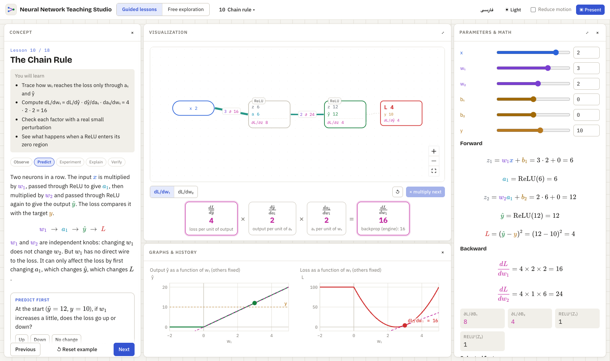
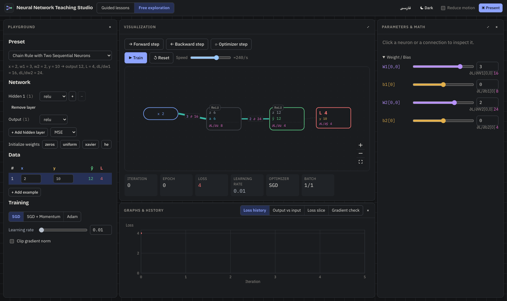

# Neural Network Teaching Studio

**English** · [فارسی](README.fa.md)

An interactive, bilingual (English / فارسی) environment for teaching neural networks from first principles: inputs and functions, weights and biases, activations, forward propagation, loss, derivatives, the chain rule, backpropagation, gradient descent and practical training.

Every number on screen comes from one small, deterministic numerical engine that runs in the browser. Change a weight, an input, an activation or the learning rate, and the network diagram, equations, gradients, plots and training history all update from the same state.



| Free exploration | Persian (right-to-left) |
| --- | --- |
|  |  |

- [Install and run (step by step, no programming needed)](#install-and-run-step-by-step)
- [Troubleshooting](#troubleshooting)
- [Modes](#modes) · [Lessons](#lessons) · [For developers](#for-developers)

## Install and run (step by step)

You don't need to know programming. The app runs on your own computer and opens in your web browser. Setting it up takes about 10 minutes the first time; after that it starts in a few seconds.

**What you need**

- A computer with Windows 10/11, macOS or Linux
- An internet connection (only for the first setup)
- A modern browser: Chrome, Edge, Firefox or Safari

### Step 1: Install Node.js (one time only)

The app is built with JavaScript and needs a free program called **Node.js** to run.

1. Go to **https://nodejs.org**.
2. Download the version marked **LTS** (the recommended one).
3. Open the downloaded file and click **Next / Continue** through the installer, keeping the default options.
4. Check that it worked:
   - **Windows**: open the Start menu, type `cmd` and open **Command Prompt**.
   - **macOS**: press `Cmd + Space`, type `Terminal` and press Enter.
   - Type the line below and press Enter:

     ```bash
     node -v
     ```

   You should see a version such as `v22.11.0`. Any version from `v20` up is fine. If you see "not recognized" or "command not found", restart the computer and try again.

### Step 2: Download the app

**Option A: download a ZIP (easiest)**

1. At the top of this page, click the green **Code** button, then **Download ZIP**.
2. Unzip it:
   - **Windows**: right-click the ZIP file → **Extract All…** → **Extract**.
   - **macOS**: double-click the ZIP file.
3. You now have a folder called `nn-teaching-studio-main`. Put it somewhere easy to find, for example on your Desktop.

**Option B: with Git (if you already use it)**

```bash
git clone https://github.com/milad9005/nn-teaching-studio.git
```

### Step 3: Start the app

**Windows**

1. Open the `nn-teaching-studio-main` folder.
2. Double-click **`start-windows.bat`**.
   - If Windows shows "Windows protected your PC", click **More info** → **Run anyway**.
3. A black window opens. The first time, it downloads the app's packages (1–3 minutes). Then your browser opens the app automatically.

**macOS**

1. Open **Terminal** (`Cmd + Space`, type `Terminal`, Enter).
2. Type `bash` followed by a space. Don't press Enter yet.
3. Drag the **`start-mac.command`** file from the folder into the Terminal window, then press Enter.
4. The first time, it downloads the app's packages (1–3 minutes). Then your browser opens the app automatically.

You can also double-click `start-mac.command`. If macOS says it "cannot be opened" or is "from an unidentified developer", open **System Settings → Privacy & Security**, scroll down and click **Open Anyway**, or just use the Terminal method above.

**Any system, by hand (also Linux)**

Open a terminal **inside the app's folder** and run these two commands:

```bash
npm install
```

```bash
npm run dev
```

Then open **http://localhost:5178** in your browser.

> To open a terminal inside the folder: on Windows, click the folder's address bar, type `cmd` and press Enter. On macOS, type `cd ` (with a space) in Terminal, drag the folder into the window and press Enter.

### Step 4: Stop and start again

- **To stop** the app, close the terminal window (or press `Ctrl + C` in it). Closing only the browser tab does not stop it.
- **To start it again later**, repeat Step 3. The package download only happens the first time, so it starts in a few seconds.
- The app works offline once installed. Your language, theme, lesson progress and panel layout are saved in the browser.

## Troubleshooting

| What you see | What to do |
| --- | --- |
| `'node' is not recognized…` or `command not found: npm` | Node.js is not installed, or the terminal was opened before installing it. Install Node.js (Step 1), then close and reopen the terminal. If it still fails, restart the computer. |
| PowerShell says `running scripts is disabled on this system` | Use **Command Prompt** (`cmd`) instead of PowerShell, or double-click `start-windows.bat`. |
| `Error: Port 5178 is already in use` | The app is already running in another terminal window. Just open http://localhost:5178, or close the other window and try again. |
| The browser does not open by itself | Open **http://localhost:5178** yourself. |
| `npm install` fails with network errors | Check your internet connection and try again. On a work network a proxy or firewall may block it. |
| `npm install` fails in some other way | Delete the `node_modules` folder inside the app's folder and run `npm install` again. Never use `sudo` with it. |
| Node.js version is too old (`v18` or lower) | Install the current LTS from https://nodejs.org; it replaces the old one. |
| macOS: `permission denied` when double-clicking `start-mac.command` | Use the Terminal method (`bash` + drag the file). |
| The page is blank or looks broken | Refresh with `Ctrl + Shift + R` (Windows) or `Cmd + Shift + R` (macOS) and use an up-to-date browser. |
| You want to reset the layout, language and progress | In the browser, clear the site data for `localhost:5178`, then refresh. |

## Using the app

- **Language**: the `فارسی` / `English` button in the top bar switches the whole interface, including right-to-left layout. Your network and values stay as they are.
- **Guided lessons**: start at lesson 1 and use **Next** at the bottom of the left panel. The lesson menu in the top bar jumps to any lesson.
- **Free exploration**: build your own network, pick a ready-made example (preset), and train it.
- **Present**: a clean full-screen view for teaching in a class, controlled from the keyboard (keys below).
- Panels can be resized by dragging their edges, closed with `×` and reopened from the buttons that appear at the edge.

## Modes

- **Guided lessons**: 18 lessons, each with objectives, an explanation split into reveal steps, predict-first prompts, an interactive demo, live equations, an optional "deeper math" section and a checkpoint. Previous / Next / Reset example are at the bottom of the left panel; the lesson menu is in the top bar.
- **Free exploration**: a full playground. Pick a preset, add or remove neurons and hidden layers, choose activations and the loss, edit inputs, targets, weights and biases, step forward / backward / optimizer, train continuously, inspect any neuron or connection, view a 1-D loss slice and run a gradient check.
- **Presentation**: distraction-free, larger type, step reveal and keyboard control.

### Presentation keys

| Key | Action |
| --- | --- |
| `→` / `Space` | Reveal the next block (then forward-step the network) |
| `←` | Hide the last revealed block |
| `PgDn` / `PgUp` | Next / previous lesson |
| `B` | Backward step |
| `A` | Hide or show advanced math |
| `L` | Laser pointer |
| `D` | Draw annotations, `C` clears them |
| `F` | Full screen |
| `Esc` | Leave presentation |

## Lessons

1. Inputs and Outputs
2. Weight and Bias
3. Activation Functions
4. Multiple Neurons
5. Forward Propagation
6. Predictions and Loss
7. Derivatives from Zero
8. Derivative of Loss with Respect to Weight
9. Multiple Weights and Partial Derivatives
10. The Chain Rule (core worked example)
11. Backpropagation
12. Gradient Descent
13. Learning Rate
14. Batch, Mini-Batch and Epoch
15. Optimizers
16. Weight Initialization
17. Overfitting and Generalization
18. Training vs Inference

## For developers

Requirements: Node 20+ and npm. The end-to-end tests use the locally installed Google Chrome, so no browser download is needed.

| Command | What it does |
| --- | --- |
| `npm run dev` | Development server at http://localhost:5178 |
| `npm test` | Unit tests (Vitest): engine math, gradients vs finite differences, presets, optimizers, lesson math |
| `npm run e2e` | End-to-end tests (Playwright, local Chrome): core example, RTL switch, stepping, training, presentation |
| `npm run typecheck` | TypeScript check |
| `npm run build` | Typecheck and production build into `dist/` |

### Architecture

```
src/
  engine/        pure TypeScript math, no React. Unit-tested.
    activations  linear, ReLU, sigmoid, tanh, softmax (+ derivatives / Jacobian)
    losses       MSE, MAE, Huber, BCE, CCE (+ gradients)
    network      dense nets: forward, backward, batch loss/grad, params, architecture edits, validation
    analysis     finite-difference gradient check, chain-rule path decomposition
    optimizers   SGD, Momentum, Adam on flat vectors (+ masks, clipping, NaN guards)
    init         zeros, constant, uniform, Xavier, He (seeded)
    training     batching schedule, epochs, one training iteration, divergence guard
    presets      the 12 named teaching scenarios
  state/
    lab.ts       the shared network workspace (Zustand). All network panels read it.
    lessonState  per-lesson state shared by a lesson's four panels
    ui.ts        language, theme, mode, lesson, panel sizes, presentation (persisted)
  i18n/          interface strings (en, fa) and preset text; lesson prose lives with lessons
  components/    Tex (KaTeX), Plot2D (SVG), PlotlyChart (3-D/contour), NetworkCanvas
                 (React Flow), Inspector, lab panels, controls, teaching blocks
  shell/         top bar, four-panel workspace, guided / explore modes, presentation layer
  lessons/       one file per lesson + registry (index.ts)
e2e/             Playwright tests
```

### One source of truth

- Network lessons and the playground read `useLab` (state) and `useLabDerived()` (forward trace, loss and gradients for the selected example, the full batch and the next mini-batch, memoized from the state). Nothing stores a copy of a computed value.
- Stand-alone lessons keep their inputs in `useLessonState(id, init)` and compute everything else from it on render.
- The forward/backward stepper only controls what is *revealed*; the values are always the engine's.

### Conventions

- **Loss normalization**: per-sample loss averages over output units (CCE sums over classes); the batch loss is the mean over samples, and the backward pass uses the same 1/N.
- **Squared error**: `L = (ŷ − y)²` without a ½, so `dL/dŷ = 2(ŷ − y)`.
- **ReLU at 0**: not differentiable; the engine uses `ReLU'(0) = 0` (like PyTorch). Gradient checks flag parameters whose finite difference crosses a ReLU kink.
- **Momentum**: `v ← βv + g; θ ← θ − lr·v`. **Adam**: standard with bias correction.
- **Numbers**: values below 1e-12 are shown as 0 (floating-point noise). Numbers and equations stay left-to-right in Persian mode.
- **Limits**: up to 4 inputs, 4 hidden layers, 10 units per layer, 32 examples. Training stops with a message on NaN/Inf or when the loss exceeds 1e8.

### Presets

| Preset | Setup | Verified result |
| --- | --- | --- |
| Single Affine Neuron | 1→1 linear, w=2, b=1, x=1.5, y=5 | z = 4, L = 1 |
| ReLU Activation Threshold | 1→1 ReLU, w=1, b=−1 | outputs 0, 0, 0, 1 for x = −1, 0.5, 1, 2 |
| One vs Multiple Neurons | 1→4 ReLU→1, target 0.5x² | ŷ(2) = 1.5 |
| Temperature Prediction | outside temp → cooling kW, 4 examples | MSE = 0.045 |
| Single-Weight Loss Landscape | L(w) = (2w − 10)² | dL/dw(3) = −16 |
| Two-Weight Loss Landscape | 2→1 linear, bias fixed | L = 37/6, ∇L = (−10/3, −11/3) |
| Chain Rule with Two Sequential Neurons | x=2, w1=3, w2=2, ReLU, y=10 | ŷ=12, L=4, dL/dw1=16, dL/dw2=24, dL/db1=8, dL/db2=4 |
| Backpropagation Through a Branching Graph | 1→2→2→1 | W1[0,0] has 2 paths of 3 each, gradient 6 |
| Gradient Descent Step by Step | lr = 0.05 | w 3 → 3.8, L 16 → 5.76 |
| Learning Rate Comparison | same start | slow / fast / oscillating / diverging (lr > 0.25) |
| Mini-Batch Training | 8 examples, batch 2 | 4 updates per epoch |
| Overfitting Demonstration | 8 noisy points, 14 validation | wide net: train loss ≪ validation loss |

All of these are asserted in `src/engine/training.test.ts` and `src/engine/engine.test.ts`.

### Adding a teaching example

**A new preset**

1. Add an id to `PresetId` and a factory to `PRESETS` in `src/engine/presets.ts` (network, data, loss, optimizer, batch, frozen parameters).
2. Add its name and intended outcome in English and Persian to `src/i18n/presets.ts`.
3. Add a test in `src/engine/training.test.ts` that asserts its expected numbers.

It then appears in the playground's preset picker, and a lesson can load it with `presetId`.

**A new lesson**

1. Create `src/lessons/lNN-name.tsx` exporting a `LessonDef` (see `src/lessons/types.ts`): `Explain` (left), `Center` (main visual), optional `Right` (parameters and equations) and `Bottom` (graphs).
2. Keep state in `useLessonState('lNN', init)` or set `presetId` and read `useLab` / `useLabDerived`. Compute every displayed value from that state with the engine.
3. Write prose with `bi('English', 'فارسی')` and `<P>` (inline math as `$...$`), split it into `<Reveal at={n}>` blocks and set `revealSteps`. Add a `<Predict>` before results and a `checkpoint`.
4. Register it in `src/lessons/index.ts`. Put pure math in `src/lessons/math/` with a unit test.
